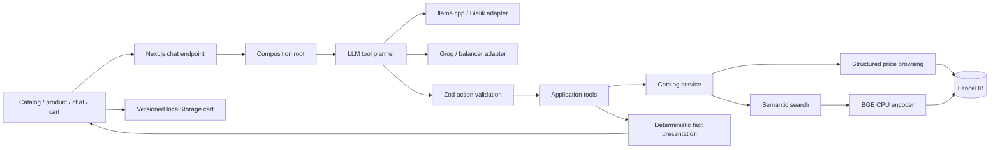

# Aurelle - an AI shopping assistant with real vector retrieval

A small, deliberately complete shopping demo: browse 48 products, inspect a product, ask an assistant for recommendations, and keep a cart across page reloads. The UI, catalog, prompts and documentation are in English; all prices are in EUR.

The interesting part is the boundary between probabilistic reasoning and reliable commerce behavior. A language model selects a validated tool. Product identity, prices, stock, policies and totals come from application code and the catalog. A model cannot create an imaginary offer or turn a successful search into an empty-catalog answer.

Built with Next.js 16 App Router, React 19, TypeScript strict, Vercel AI SDK 7, Zod, embedded LanceDB and local CPU embeddings. The visual starting point and product photographs come from [dilums/kimi-k3-ecommerce-storefront](https://github.com/dilums/kimi-k3-ecommerce-storefront). Additional mock products use explicitly marked local SVG illustrations. This is a portfolio demo, without payment processing or order fulfillment.


## Start with an agent

Give your coding agent [STARTER_PROMPT.md](STARTER_PROMPT.md) after cloning. It instructs the agent to inspect the project, detect available providers, offer local llama.cpp or Groq setup, prepare the real vector database and verify the complete shopping flow. It never assumes the author's private endpoints or credentials exist on your machine.

[Initial brief](docs/INITIAL_BRIEF.md) records the original assignment and how this project evolved beyond it.

## Run manually

Use Node.js 22 or later on Linux, macOS or Windows with a supported native architecture. Linux x64 / WSL is the verified development environment. The native LanceDB and ONNX dependencies do not support FreeBSD out of the box.

```bash
git clone https://github.com/MichalSalek/ecommerce-agent-ai.git
cd ecommerce-agent-ai
npm ci
cp .env.example .env.local
# Configure one chat provider below.
npm run catalog:prepare
npm run dev
```

Open http://localhost:3000, http://localhost:3000/chat and http://localhost:3000/cart. Products live at `/products/<id>` (for example `/products/mugs`). If port 3000 is occupied, Next prints the actual port. Preparation downloads the pinned BGE weights on first use (about 34 MB) and creates the LanceDB table. Internet access is needed for that first download; the cache is local afterwards. The database is also prepared lazily, but explicit preparation avoids a download during a customer conversation.

### Local llama.cpp / Bielik

Start a compatible llama.cpp server with your own GGUF file, then inspect its model ID:

```bash
llama-server -m /path/to/model.gguf --host 127.0.0.1 --port 8080 --jinja
curl http://127.0.0.1:8080/v1/models
```

```dotenv
CHAT_PROVIDER=llama
LLAMA_BASE_URL=http://127.0.0.1:8080/v1
# Optional: exact ID returned by /v1/models.
LLAMA_MODEL=your-model-id
```

The adapter discovers the model and requests JSON object mode. Native function calling is not required. The model must follow the tool-selection protocol. The Bielik compatibility parser also supports its template's legacy `<tool_call>` dictionaries with single quotes through JSON5 data parsing, followed by the same Zod validation; no eval is used. Tested locally with **Bielik PL 11B v3.0 Instruct Q8_0**, served by Windows llama-swap and reached from WSL. A local runtime is not automatically a production endpoint; a remote deployment cannot reach your laptop's localhost.

### Groq API

Groq (the inference provider) is different from xAI Grok. The application integrates with Groq, not a Cursor model session.

```dotenv
CHAT_PROVIDER=groq
GROQ_BASE_URL=https://api.groq.com/openai/v1
GROQ_MODEL=openai/gpt-oss-120b
GROQ_API_KEY=your-existing-key
```

Set a real key only in `.env.local` or a hosting secret store. No key is sent to the browser. The direct API path is covered by the same adapter contract; the live acceptance run used the balancer configuration below, not a separately verified direct key.

### Optional Groq balancer

An existing OpenAI-compatible balancer can own the credentials and quotas:

```dotenv
CHAT_PROVIDER=groq
GROQ_BASE_URL=http://127.0.0.1:8787/v1
GROQ_MODEL=openai/gpt-oss-120b
GROQ_BALANCER=true
# Use only when the balancer runs on Windows loopback and Next runs in WSL:
GROQ_TRANSPORT=windows
```

This adapter deliberately sends `/v1/background/chat/completions`, `X-Balancer-Client: aurelle-demo` and a purpose header. It uses the balancer's background policy instead of its dictation-cleanup path, preserving the owner's reserved dictation quota. The balancer, not the shop, owns credential rotation and budget accounting. Optional bearer authentication uses `GROQ_API_KEY`; no vault file is read by the application. Windows transport invokes `curl.exe` with arguments and a JSON body on stdin, without a shell. It is optional and loopback-only, with timeout and cancellation.

Live-tested model: **openai/gpt-oss-120b through the existing Groq balancer**. The completion allowance is 3000 tokens so the reasoning model can finish a JSON action. There is no silent provider fallback. The current local installation selects this provider; a fresh clone defaults to llama.cpp.

## Architecture



The source follows ports and adapters with small domain boundaries, rather than a framework-heavy DDD implementation:

| Layer | Responsibility | Examples |
| --- | --- | --- |
| Domain | Product and cart contracts, quantities, stock rules, integer-cent totals, store policies | `src/domain/catalog`, `src/domain/cart` |
| Application | Interpret search intent, browse vs semantic search, tool contracts and policy | `src/application/catalog`, `src/application/chat` |
| Infrastructure | LanceDB persistence, BGE inference, llama.cpp/Groq transport, UI stream encoding | `src/infrastructure` |
| Composition | Choose adapters and read deployment configuration | `src/composition` |
| Presentation | Pages, shared cards, client cart lifecycle and search/filter controls | `src/app`, `src/components` |

The domain imports neither Next.js nor the AI SDK, LanceDB or ONNX. The repository and embedding ports separate business intent from persistence and inference. Application use cases receive dependencies explicitly. Transport quirks such as Windows loopback are isolated in an adapter.

### What happens during a conversation

1. The API validates the UI-message structure and converts it to model messages. Invalid requests return an HTTP error; the request has a 90-second deadline.
2. A pure budget question such as `What can I buy under EUR 25?` is recognized deterministically. It uses a structured database filter, not vector similarity to generic words such as “what can I buy.”
3. Requests naming an explicit product ID use the detail tool directly. Other requests go to the selected LLM once. Its JSON action must match one of `searchProducts`, `getProductDetails`, `getPolicy` or `refuse` and the tool-specific Zod schema. Unknown tools and invalid arguments are rejected before execution.
4. The selected application tool executes. Semantic queries embed the product intent and query LanceDB; price-only browsing filters and sorts the stored catalog directly.
5. Results are streamed as typed AI SDK tool parts. The client renders actual product cards and detail links. A deterministic response reports the successful result or the actual empty state. There is no second LLM summary that could contradict the data or invent prices and URLs.

This is intentionally a bounded shopping agent, not an unrestricted autonomous agent. Provider errors remain visible, are not disguised as “no products,” and do not trigger unannounced cloud fallback. Tool execution is server-side. Model compliance on arbitrary adversarial requests is not guaranteed; the validated tool boundary limits what a model can execute.

### Retrieval

Bielik/Groq selects actions; it does not produce embeddings. [BGE small English v1.5](https://huggingface.co/BAAI/bge-small-en-v1.5), using [Xenova's ONNX distribution](https://huggingface.co/Xenova/bge-small-en-v1.5), runs independently on CPU. The encoder uses q8, CLS pooling, normalization, a retrieval query prefix and 384 dimensions. Weights are pinned to revision `ea104dacec62c0de699686887e3f920caeb4f3e3`.

LanceDB is embedded and persistent under `.data/lancedb`; no database daemon or vector service is required. For 48 products, exact cosine search is appropriate. Semantic search applies the budget filter, selects at most two nearest candidates and drops distances above 0.45. This cutoff is a demo calibration, not a relevance guarantee. Structured browsing returns up to 12 products ordered by price and ID, without a similarity cutoff. Category and text filters on the home page are deterministic UI controls, distinct from semantic recommendations.

The table name fingerprints the complete catalog and embedding identity. Price, stock, URL, description or encoder changes produce a new table, avoiding stale records and mixed embedding spaces. Old derived tables are retained; stop the app before removing `.data/lancedb` to rebuild. Cache paths are configurable through `LANCEDB_DIR` and `EMBEDDING_CACHE_DIR`.

### Cart and product pages

Each of the 48 products has a generated page with availability, policy summary, related items and an assistant deep link carrying its ID. Unknown IDs produce a 404.

The cart stores only product IDs and bounded integer quantities in a versioned localStorage document. Prices, names, currency and stock are always read from the current catalog; persisted browser values cannot supply a price. Malformed or incompatible storage recovers to an empty cart, missing products are removed, duplicate IDs are normalized, out-of-stock additions are rejected, and quantities are capped at 99. Totals use integer cents. Storage events synchronize tabs; storage failure leaves an in-memory cart and a visible notice. Initial hydration completes before storage is written.

There is deliberately no checkout, payment, account or backend order database. Demo shipping is EUR 4 and the mock return window is 14 days. A local cart is not a server-authoritative order or cross-device basket.

## Verification

```bash
npm run catalog:prepare
npm test
npm run typecheck
npm run build
npm start
```

The tests exercise real BGE vectors and a temporary LanceDB database, semantic ranking, budget-only browsing, invalid budgets, persistence and catalog refresh. They also cover cart restoration/quantity/stock/price rules, JSON parsing, model action validation and provider HTTP contracts. Unit tests do not spend cloud tokens. First execution may download BGE weights. Live checks are recorded separately in [verification evidence](docs/VERIFICATION.md).

Acceptance examples:

- `What can I buy under EUR 25?` - real affordable products, including cutlery, rather than a semantic false negative.
- `Something for my morning coffee under EUR 25` - vector recommendations with the price bound.
- `Tell me about product mugs` - actual product details.
- `How much is delivery?` - the static policy.
- `Write a Python loop` - refusal and a return to shopping.
- Add from a product page or a chat card, change quantity, reload `/cart`, remove an item.

Logs use `[AGENT]`, `[LLM]`, `[TOOL]`, `[VECTOR]`, `[EMBEDDING]` and `[CART]`. Full model output, credentials and complete conversations are not logged in loops.

## Hosting

Nothing has been deployed. See [hosting options](docs/HOSTING.md) before choosing a target. This is a Next Node application with native CPU inference and persistent vector storage, not a static-only website. A Linux Node service with persistent storage is the natural target; Groq removes the need to host a chat model/GPU. Do not expose the private Windows balancer publicly.

Before a public interactive deployment, define provider credentials and cost/access limits. The current demo has no authentication or durable distributed rate limiter. The repository includes `.env.example`, excludes credentials/models/database caches and keeps template attribution. Publishing source code does not require publishing private endpoints or credentials.
