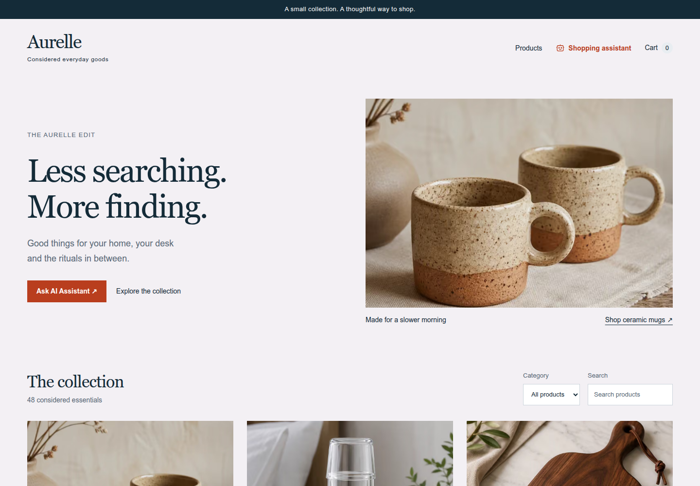
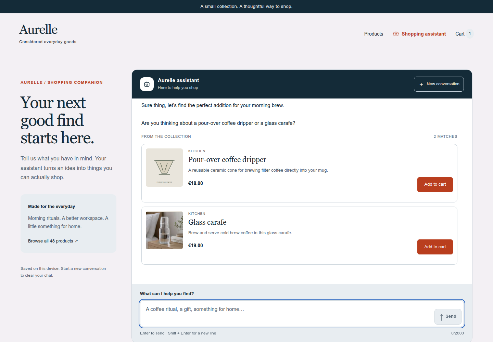
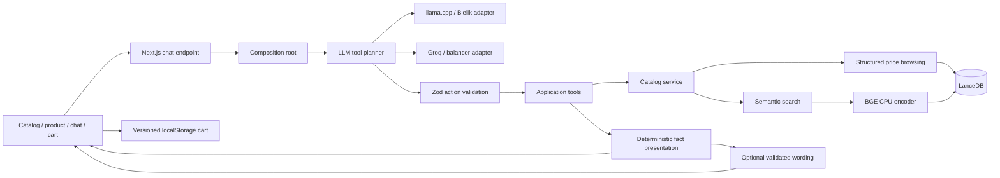

# Aurelle - an AI shopping assistant with real vector retrieval

A small, deliberately complete shopping demo: browse 48 products, inspect a product, ask an assistant for recommendations, and keep a cart across page reloads. The UI, catalog, code and documentation are in English; the assistant follows the customer language. Polish and English have grounded fallback replies, and live Spanish search narration is also verified. All catalog prices remain in EUR.

The interesting part is the boundary between probabilistic reasoning and reliable commerce behavior. A language model selects validated tools and can supply conversational transitions. Product identity, prices, stock, policies, currency handling and ranking remain in application code and the catalog. Optional generated wording is validated and never supplies a numeric price; contextual fallback replies keep retrieved facts available if narration fails.

Built with Next.js 16 App Router, React 19, TypeScript strict, Vercel AI SDK 7, Zod, embedded LanceDB and local CPU embeddings. The visual starting point and product photographs come from [dilums/kimi-k3-ecommerce-storefront](https://github.com/dilums/kimi-k3-ecommerce-storefront). Additional mock products use explicitly marked local SVG illustrations. This is a portfolio demo, without payment processing or order fulfillment.





## Start with an agent

Give your coding agent [STARTER_PROMPT.md](STARTER_PROMPT.md) after cloning. It instructs the agent to inspect the project, detect available providers, offer local llama.cpp or Groq setup, prepare the real vector database and verify the complete shopping flow. It never assumes the author's private endpoints or credentials exist on your machine.

[Initial brief](docs/INITIAL_BRIEF.md) records the original assignment and how this project evolved beyond it.

## Run manually

Use Node.js 22 or later on Linux, macOS or Windows with a supported native architecture. Linux x64 / WSL is the verified development environment. The native LanceDB and ONNX dependencies do not support FreeBSD out of the box.

```bash
git clone https://github.com/MichalSalek/ecommerce-agent-ai.git
cd ecommerce-agent-ai
npm ci
cp .env.example .env.local
# Configure one chat provider below.
npm run catalog:prepare
npm run dev
```

Open http://localhost:3000, http://localhost:3000/chat and http://localhost:3000/cart. Products live at `/products/<id>` (for example `/products/mugs`). If port 3000 is occupied, Next prints the actual port. Preparation downloads the pinned BGE weights on first use (about 34 MB) and creates the LanceDB table. Internet access is needed for that first download; the cache is local afterwards. The database is also prepared lazily, but explicit preparation avoids a download during a customer conversation.

### Local llama.cpp / Bielik

Start a compatible llama.cpp server with your own GGUF file, then inspect its model ID:

```bash
llama-server -m /path/to/model.gguf --host 127.0.0.1 --port 8080 --jinja
curl http://127.0.0.1:8080/v1/models
```

```dotenv
CHAT_PROVIDER=llama
LLAMA_BASE_URL=http://127.0.0.1:8080/v1
# Optional: exact ID returned by /v1/models.
LLAMA_MODEL=your-model-id
```

The adapter discovers the model and requests JSON object mode. Native function calling is not required. The model must follow the tool-selection protocol. The Bielik compatibility parser also supports its template's legacy `<tool_call>` dictionaries with single quotes through JSON5 data parsing, followed by the same Zod validation; no eval is used. Tested locally with **Bielik PL 11B v3.0 Instruct Q8_0**, served by Windows llama-swap and reached from WSL. A local runtime is not automatically a production endpoint; a remote deployment cannot reach your laptop's localhost.

### Groq API

Groq (the inference provider) is different from xAI Grok. The application integrates with Groq, not a Cursor model session.

```dotenv
CHAT_PROVIDER=groq
GROQ_BASE_URL=https://api.groq.com/openai/v1
GROQ_MODEL=openai/gpt-oss-120b
GROQ_API_KEY=your-existing-key
```

Set a real key only in `.env.local` or a hosting secret store. No key is sent to the browser. The direct API path is covered by the same adapter contract; the live acceptance run used the balancer configuration below, not a separately verified direct key.

### Optional Groq balancer

An existing OpenAI-compatible balancer can own the credentials and quotas:

```dotenv
CHAT_PROVIDER=groq
GROQ_BASE_URL=http://127.0.0.1:8787/v1
GROQ_MODEL=openai/gpt-oss-120b
GROQ_BALANCER=true
# Use only when the balancer runs on Windows loopback and Next runs in WSL:
GROQ_TRANSPORT=windows
```

This adapter deliberately sends `/v1/background/chat/completions`, `X-Balancer-Client: aurelle-demo` and a purpose header. It uses the balancer's background policy instead of its dictation-cleanup path, preserving the owner's reserved dictation quota. The balancer, not the shop, owns credential rotation and budget accounting. Optional bearer authentication uses `GROQ_API_KEY`; no vault file is read by the application. Windows transport invokes `curl.exe` with arguments and a JSON body on stdin, without a shell. It is optional and loopback-only, with timeout and cancellation.

Live-tested model: **openai/gpt-oss-120b through the existing Groq balancer**. The completion allowance is 3000 tokens so the reasoning model can finish a JSON action. There is no silent provider fallback. The current local installation selects this provider; a fresh clone defaults to llama.cpp.

## Architecture



The source follows ports and adapters with small domain boundaries, rather than a framework-heavy DDD implementation:

| Layer | Responsibility | Examples |
| --- | --- | --- |
| Domain | Product and cart contracts, quantities, stock rules, integer-cent totals, store policies | `src/domain/catalog`, `src/domain/cart` |
| Application | Interpret search intent, browse vs semantic search, tool contracts and policy | `src/application/catalog`, `src/application/chat` |
| Infrastructure | LanceDB persistence, BGE inference, llama.cpp/Groq transport, UI stream encoding | `src/infrastructure` |
| Composition | Choose adapters and read deployment configuration | `src/composition` |
| Presentation | Pages, shared cards, client cart lifecycle and search/filter controls | `src/app`, `src/components` |

The domain imports neither Next.js nor the AI SDK, LanceDB or ONNX. The repository and embedding ports separate business intent from persistence and inference. Application use cases receive dependencies explicitly. Transport quirks such as Windows loopback are isolated in an adapter.

### What happens during a conversation

1. The API validates the UI-message structure and converts it to model messages. Invalid requests return an HTTP error; the request has a 90-second deadline.
2. A pure budget question such as `What can I buy under EUR 25?` is recognized deterministically. It uses a structured database filter, not vector similarity to generic words such as “what can I buy.”
3. Explicit product IDs, language changes, greetings, category requests, broad home requests and continuation of earlier searches have structured handling. Other requests use a validated LLM action: `searchProducts`, `getProductDetails`, `getCategories`, `getPolicy`, conversational `respond` or `refuse`. Unsupported actions produce a clarifying question instead of an unexplained blank turn.
4. The selected application tool executes. Semantic queries embed the product intent and query LanceDB; price-only browsing filters and sorts the stored catalog directly.
5. Results are streamed as typed AI SDK tool parts. The client renders actual product cards and detail links. An optional narration call writes only a brief opening and a relevant next question in the customer language, using the conversation and returned product names/categories. Digits, currencies, URLs, empty-inventory claims after successful retrieval and payment offers are rejected. Narration has an eight-second deadline and falls back to contextual replies; it never creates catalog facts. A free-form successful search can therefore use two model calls; structured requests need no model decision.

This is intentionally a bounded shopping agent, not an unrestricted autonomous agent. Provider errors remain visible, are not disguised as “no products,” and do not trigger unannounced cloud fallback. Tool execution is server-side. Model compliance on arbitrary adversarial requests is not guaranteed; the validated tool boundary limits what a model can execute.

### Retrieval

Bielik/Groq selects actions; it does not produce embeddings. [BGE small English v1.5](https://huggingface.co/BAAI/bge-small-en-v1.5), using [Xenova's ONNX distribution](https://huggingface.co/Xenova/bge-small-en-v1.5), runs independently on CPU. The local default BGE profile uses q8, CLS pooling, normalization, a retrieval query prefix and 384 dimensions, pinned to `ea104dacec62c0de699686887e3f920caeb4f3e3`. The Render/Docker profile selects the smaller `Xenova/all-MiniLM-L6-v2` q8 encoder (about 23 MiB), mean pooling, no query prefix, the same 384 dimensions and revision `751bff37182d3f1213fa05d7196b954e230abad9`. Set `EMBEDDING_MODEL=bge` or `minilm`. Each has its own vector fingerprint and calibrated distance cutoff (0.45 / 0.74); dimensions alone do not make embedding spaces interchangeable. Native tests exercise both profiles.

LanceDB is embedded and persistent under `.data/lancedb`; no database daemon or vector service is required. For 48 products, exact cosine search is appropriate. Semantic search applies the budget filter, selects at most two nearest candidates and drops distances above the selected profile cutoff. This cutoff is a demo calibration, not a relevance guarantee. Structured browsing returns up to 12 products ordered by price and ID, without a similarity cutoff. Category and text filters on the home page are deterministic UI controls, distinct from semantic recommendations.

The table name fingerprints the complete catalog and embedding identity. Price, stock, URL, description or encoder changes produce a new table, avoiding stale records and mixed embedding spaces. Old derived tables are retained; stop the app before removing `.data/lancedb` to rebuild. Cache paths are configurable through `LANCEDB_DIR` and `EMBEDDING_CACHE_DIR`.

### Conversation and price meaning

The conversation adapter derives language preference, previous search constraints and already shown product IDs from validated message history. `Something else?` reuses the earlier intent and excludes displayed products; `continue` can recover a preceding unanswered user question. Broad home requests return two examples and ask about a category. Actual categories come from a repository operation rather than model recall. Reply wording is action-specific and can be generated in the customer language; the static fallback is not prepended to every answer.

`maxPrice` is a hard ceiling. `targetPrice` is an approximate price target: candidates within 20% or EUR 5 are ranked by absolute distance from the target, after semantic/category constraints. For home items around EUR 30, the EUR 32 vase ranks ahead of the EUR 14 candle. Approximate ranking is a documented demo policy, not an exchange rate or a universal recommendation metric.

Foreign currency amounts (USD, PLN, GBP and CHF) are not silently interpreted as EUR. The assistant may show explicitly labeled EUR price-level examples and asks the shopper to confirm a euro budget. It does not claim those examples are a currency conversion. No live FX feed is integrated.

The failed question remains in chat and the UI offers `Try again`; a failed model request is not an empty-catalog result. The source language remains English while localized assistant replies are intentional application content.

### Chat interaction and persistence

The conversation is owned by a shared client provider above route navigation, not by the `/chat` page. Returning from a product preserves the same active conversation. A versioned localStorage snapshot also retains settled messages and the draft across reloads. Partial tool calls are discarded on restore; product cards are rehydrated from the canonical catalog, so browser storage cannot supply a price. The saved conversation is bounded to 60 messages, while transport/model context has its own smaller budget.

Enter sends, Shift+Enter adds a line, and IME composition is not submitted as a message. The textarea grows with the draft. Incoming replies follow the bottom only while the reader is there; a jump-to-latest control appears when reading earlier content. Product recommendations are compact, and large result sets disclose the remaining matches on request. Missing pictures have a visible fallback.

`New conversation` cancels the old request and creates a fresh chat instance with a welcome message. A late response cannot enter the new topic. It clears the saved chat/draft, not the cart. Saved incomplete requests offer a resume action, and transport errors preserve the question with a retry action. Storage failure leaves an in-memory conversation and a visible notice.

The morning-coffee starter is a clear shopping intent: real retrieval runs before a clarifying question. An explicit regression fixture supplies the old question-only model response and verifies that two actual products still appear.

Model context is compacted separately from UI history: recent text, search inputs and product IDs/names are retained, while full product records and image URLs are omitted. This avoids replaying the entire visible transcript into the free provider's token budget. It does not silently erase the displayed conversation.

### Cart and product pages

Each of the 48 products has a generated page with availability, policy summary, related items and an assistant deep link carrying its ID. Unknown IDs produce a 404.

The cart stores only product IDs and bounded integer quantities in a versioned localStorage document. Prices, names, currency and stock are always read from the current catalog; persisted browser values cannot supply a price. Malformed or incompatible storage recovers to an empty cart, missing products are removed, duplicate IDs are normalized, out-of-stock additions are rejected, and quantities are capped at 99. Totals use integer cents. Storage events synchronize tabs; storage failure leaves an in-memory cart and a visible notice. Initial hydration completes before storage is written.

There is deliberately no checkout, payment, account or backend order database. Demo shipping is EUR 4 and the mock return window is 14 days. A local cart is not a server-authoritative order or cross-device basket.

## Verification

```bash
npm run catalog:prepare
npm test
npm run typecheck
npm run build
npm start
```

The tests exercise real BGE vectors and a temporary LanceDB database, semantic ranking, budget-only browsing, invalid budgets, persistence and catalog refresh. They also cover cart restoration/quantity/stock/price rules, JSON parsing, model action validation and provider HTTP contracts. Unit tests do not spend cloud tokens. First execution may download BGE weights. Live checks are recorded separately in [verification evidence](docs/VERIFICATION.md).

Acceptance examples:

- `What can I buy under EUR 25?` - real affordable products, including cutlery, rather than a semantic false negative.
- `Something for my morning coffee under EUR 25` - vector recommendations with the price bound.
- `Tell me about product mugs` - actual product details.
- `How much is delivery?` - the static policy.
- `Write a Python loop` - refusal and a return to shopping.
- Add from a product page or a chat card, change quantity, reload `/cart`, remove an item.

Logs use `[AGENT]`, `[LLM]`, `[TOOL]`, `[VECTOR]`, `[EMBEDDING]` and `[CART]`. Full model output, credentials and complete conversations are not logged in loops.

## Browser and container checks

```bash
npx playwright install chromium
npm run test:e2e
# Requires Docker; uses MiniLM by default.
docker build -t aurelle-demo:render-ready .
npm run container:smoke
```

The browser suite uses an intercepted model stream to isolate Enter/newline, route return/reload, draft persistence, reset during generation, scroll behavior, mobile geometry and image-failure handling. Real LLM checks are separate. The Docker test uses actual CPU embeddings/LanceDB with an intentionally offline model endpoint, under 512 MiB and 0.1 CPU, including deleting/rebuilding the derived index. It creates/removes only its own temporary container and does not deploy publicly.

`npm start` launches the generated standalone build, copies public/static assets and loads the source project's local environment. Docker uses the generated server directly and supplies its environment at runtime. The lightweight `/api/health` reports liveness/revision/profile without calling the LLM or indexing.

## Hosting

No external deployment exists yet. A validated `render.yaml`, non-root CPU Dockerfile and executable [Render Free launch plan](docs/RENDER_FREE_PLAN.md) are prepared. The remaining owner gates are the new account/workspace, the cloud Groq secret/quota decision and the monitoring account. See [hosting options](docs/HOSTING.md) for alternatives. This is a Next Node application with native CPU inference and persistent vector storage, not a static-only website. A Linux Node service with persistent storage is the natural target; Groq removes the need to host a chat model/GPU. Do not expose the private Windows balancer publicly.

Before a public interactive deployment, define provider credentials and cost/access limits. Production has per-instance admission controls (two concurrent chat requests and 120 valid chat POSTs per rolling hour by default, configurable with `CHAT_MAX_CONCURRENT` / `CHAT_REQUESTS_PER_HOUR`). Retries count as requests; liveness does not. These in-memory controls reset on restart and are not authentication, durable distributed rate limiting or a billing cap. The repository includes `.env.example`, excludes credentials/models/database caches and keeps template attribution. Publishing source code does not require publishing private endpoints or credentials.

## Explaining the agent and its guardrails

See [AGENT_ARCHITECTURE.md](docs/AGENT_ARCHITECTURE.md) for execution-path tables, why a structured shopping answer can take about 100 ms without an LLM call, the difference between cached weights/index/session and a response cache, context boundaries, errors, quotas and honest interview positioning.

A conversation now closes after 20 customer messages or 24000 textual characters, warns for its last three turns, disables the composer and invites a new topic while keeping the cart. The server independently enforces excessive-history rejection; it is a simple application lifetime policy, not exact tokenizer accounting or a secure identity boundary. Existing model-context compaction and request deadlines remain separate safeguards. Dev runs Webpack in `.next-development` so production builds do not overwrite its output.

[Next project proposals](docs/NEXT_PROJECTS.md) cover a Python document workflow, a Spring Boot support copilot and a static-site service assistant with a small server-side Groq proxy; these are proposals, not implemented products.

## Try the full demo without reading the source first

The chat page explicitly identifies the catalog, prices, availability and policies as mock data. Its **Try the implemented features** guide contains clickable scenarios and the boundaries of the demo, including persistence, language, conversation lifetime and retry.

New discovery capabilities:

- `Compare mugs and carafe` invokes the validated `compareProducts` tool, reads both canonical records, shows their cards and computes the EUR price difference in application code. Comparisons accept two or three distinct known IDs and report unknown IDs; they do not invent quality scores. After recommendations, `Compare these products` resolves the latest shown search results rather than guessing another pair.
- `Find a gift under EUR 25` returns two available catalog starting points within the hard budget and asks about the recipient. This is a deliberately broad discovery starting point, not an assertion that every item suits every recipient.
- `Show only in-stock products` reuses the preceding search constraints when present and adds a true database availability filter. If there is no earlier search, it browses available products. Availability filtering is independent of semantic similarity and prices.

The comparison tool participates in native action schemas, model instructions, UI tool rendering and versioned history restoration. Restored comparison cards again take their prices/stock from the canonical catalog. New tools use the existing repository/service boundary instead of creating a parallel data source.
